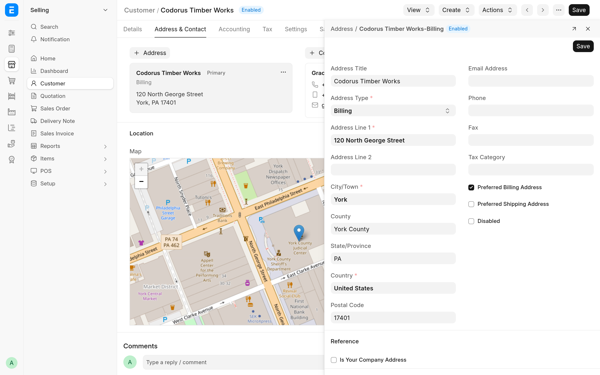

<!-- Copyright (c) 2026, Avunu LLC and contributors
For license information, please see license.txt-->

<!-- frappe-nix:begin header -->

<div align="center">


# CIS Plus for ERPNext

Address geocoding and location maps for customers and suppliers

[](https://github.com/Avunu/erpnext_cis_plus/actions/workflows/ci.yml)
[](https://github.com/Avunu/erpnext_cis_plus/releases)
[](license.txt)
[](https://github.com/frappe/frappe/tree/version-16)

<picture>
  <source media="(prefers-color-scheme: dark)" srcset="docs/screenshots/customer-form-dark.webp">
  
</picture>

</div>

<!-- frappe-nix:end header -->

## Overview

ERPNext keeps customers, contacts and addresses as separate records linked together. That is flexible, but for a small business, where most customers have one contact and one address, it means a lot of moving between forms. CIS Plus (originally "Customer Information System Enhancements for ERPNext") geocodes addresses through the free OpenStreetMap Nominatim service and shows each Address's, Customer's and Supplier's location on a map on its form.

It also lets you edit a Customer's or Supplier's addresses and contacts in Frappe's side panel, next to the party's form, so the common case is handled without moving between forms.

Full documentation: [docs.avunu.net/erpnext-cis-plus/docs/](https://docs.avunu.net/erpnext-cis-plus/docs/).

## Features

- **Address geocoding.** When an Address is saved with a new or changed address, or still has no coordinates, it is looked up on Nominatim. Its latitude and longitude are stored, a point is drawn on a new **Location** map on the Address, and its country, postal code, state, county and city are filled in where they are blank (a United States state name becomes its two-letter code).
- **Location on the Customer and Supplier.** A **Location** section on both forms shows the primary address's point on a map. It follows the address: a new primary address, another one chosen on the party, or a geocoded change to the Address itself moves the point.
- **Addresses and contacts edited in the side panel.** On the **Address & Contact** tab of a Customer or Supplier, clicking an address or contact card opens it in the side panel (Frappe v16's right-hand drawer) as a form, with a **Save** button (or Ctrl+S); the **Address** and **Contact** add buttons open a new one there. The party's form stays open underneath, unsaved changes included, and its cards and map are brought up to date after each save. A new record is linked to the party, and a party's first address or contact becomes its primary one. The card menu keeps its **Edit** (the full form), **Set as Primary** and **Unlink Address** or **Unlink Contact** entries.

  

- **A new address's country.** A new Address saved from the side panel with no country takes the one the geocoding result gives; when the lookup fails or finds nothing, it takes the Supplier's own country, or the System Settings country.
- **Phone numbers in E.164.** Phone and mobile numbers added to a Contact in the side panel are converted to E.164 (`+17175550142`) with the [`phonenumbers`](https://pypi.org/project/phonenumbers/) package, using the country of the party's primary address, or the System Settings country. Numbers the Contact already had are left as they are. A number that cannot be parsed is kept as typed and an alert says so.
- **Primary address and contact by default.** When a Customer or Supplier is opened and has no primary address or contact, the first linked one is selected; saving the party keeps it.

<!-- frappe-nix:begin compatibility -->

## Compatibility

| Frappe | Branch       |
| ------ | ------------ |
| v16    | `version-16` |

| Requires                                     | Version            |
| -------------------------------------------- | ------------------ |
| [erpnext](https://github.com/frappe/erpnext) | `>=16.0.0,<17.0.0` |

<!-- frappe-nix:end compatibility -->

<!-- frappe-nix:begin installation -->

## Installation

```bash
bench get-app https://github.com/Avunu/erpnext_cis_plus --branch version-16
bench --site <site> install-app erpnext_cis_plus
```

<!-- frappe-nix:end installation -->

Until the first release creates the `version-16` branch, install from `develop` instead: `bench get-app https://github.com/Avunu/erpnext_cis_plus --branch develop`. The app needs ERPNext, installed first.

Updating from a version with primary address and contact fields on the Customer and Supplier form: `bench --site <site> migrate` runs a patch that removes those custom fields. Nothing is lost: they were copies of the primary Address and Contact. What installing, upgrading and uninstalling change is in [docs/install.md](docs/install.md).

## Configuration

There is nothing to configure. Three things are worth knowing:

- Geocoding needs outbound HTTPS from the bench to `nominatim.openstreetmap.org`. The maps load their tiles from OpenStreetMap in the browser, as Frappe's maps always do.
- Phone numbers without a country code are read in the country of the party's primary address, or of **System Settings > Country** when there is none, so set that country.
- Editing in the side panel follows Frappe's split view setting: it is on unless a user turns off **Split view** on the **Reports** tab of their **Settings** (`report_split_view`), and never on a phone. When it is off, the cards and the **Address** and **Contact** add buttons keep their standard behaviour (the card menu's **Edit** opens the full form, and the buttons open the quick entry).

The permissions the app checks and everything it adds to a site are listed in [docs/configuration.md](docs/configuration.md).

## How It Works

- `hooks.py` adds form scripts for Customer and Supplier, list settings for Customer, and `doc_events` for Address. The custom fields live in `erpnext_cis_plus/erpnext_cis_plus/custom/` and are synced on install and migrate.
- **Address `validate`** looks the address up on Nominatim, following [its usage policy](https://operations.osmfoundation.org/policies/nominatim/): an identifying User-Agent, at most one request per second from the bench (shared through Redis), and a 5-second connect and 10-second read timeout. The stored coordinates are the cache. **Address `before_save`** turns them into the map's GeoJSON point, and **Address `on_update`** copies a changed point to the parties whose primary address it is; the parties also fetch it from their primary address when saved.
- **The side panel** (`public/js/party_records.js`) wraps the prototype of Frappe's `SidePanel` so that the records opened from a party's cards are drawn as an editable form; every other preview in the panel is Frappe's own. **Save** calls `party_utils.save_party_record`, which saves the record with the user's own permissions, links a new one to the party and writes new phone numbers in E.164.

The full description is in [docs/development/architecture.md](docs/development/architecture.md).

## Limitations

- **The list map views do not open on Frappe v16.** The app's location fields make Frappe offer a **Map** view on the Address, Customer and Supplier lists, but opening it fails in Frappe itself with `TypeError: this.load_lib is not a function` (`MapView.setup_view` calls `this.load_lib()`, which `ListView`, the class `MapView` extends, replaces with a promise). The **Location** maps on the Address, Customer and Supplier forms are not affected.
- Geocoding sends the address text to the public Nominatim service and is meant for modest volumes: one lookup per second for the whole bench. An import of many addresses goes at that pace, and saves that wait more than five seconds for a slot skip their lookup; saving each of those Addresses again retries it.
- Addresses and contacts are added in the side panel once the Customer or Supplier is saved. The side panel form leaves out the map and the **Links** table, and closing the panel drops unsaved edits in it without asking.

All limitations, and the messages the app shows with their fixes, are in [docs/troubleshooting.md](docs/troubleshooting.md).

<!-- frappe-nix:begin support -->

## Support

- Bug reports and questions: [GitHub issues](https://github.com/Avunu/erpnext_cis_plus/issues)
- E-mail: <mail@avu.nu>

<!-- frappe-nix:end support -->

<!-- frappe-nix:begin development -->

## Development

```bash
nix develop        # or: direnv allow
prek install       # the git hooks CI runs
frappe-test        # the tests, the way CI runs them
```

The managed files, checks and release flow are described in the [app standards documentation](https://docs.avunu.net/frappe-nix/docs/app-standards/).

<!-- frappe-nix:end development -->

The source layout and the commands for tests and screenshots are described in [docs/development/README.md](docs/development/README.md).

<!-- frappe-nix:begin license -->

## License

MIT, Copyright (c) 2024–present Avunu LLC → [license.txt](license.txt)

<!-- frappe-nix:end license -->
