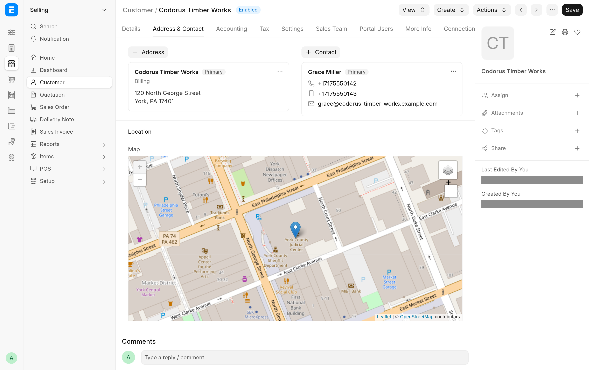
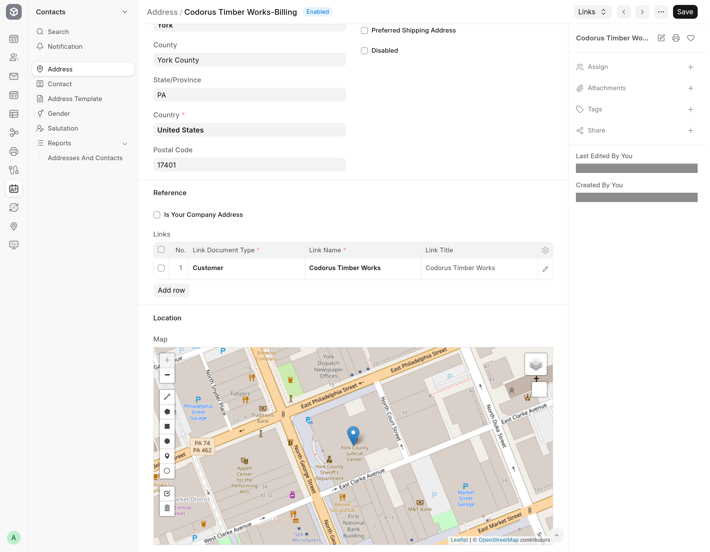

# CIS Plus for ERPNext

Address geocoding and location maps for customers and suppliers

ERPNext keeps customers, contacts and addresses as separate records linked together. CIS Plus geocodes addresses through the free OpenStreetMap Nominatim service and shows the location of each Address, Customer and Supplier on a map on its form. It also adds primary address and contact fields to the Customer and the Supplier form that create or update the linked Address and Contact.



## What it does

- **Address geocoding.** When an Address is saved with a new or changed address, or still has no coordinates, it is looked up on Nominatim. Its latitude and longitude are stored, a point is drawn on a new **Location** map on the Address, and its country, postal code, state, county and city are filled in where they are blank.
- **Location on the Customer and Supplier.** A **Location** section on both forms shows the primary address's point on a map, and follows the address when it changes or moves.
- **Primary address and contact fields on the party.** In the **Primary Address and Contact** section of the **Address & Contact** tab (ERPNext v16 hides that section; the app shows it again). Saving an existing Customer or Supplier with its primary address and contact fields set creates the Address and Contact, links them and marks them primary, or updates the ones already linked.
- **Phone numbers in E.164** for the primary contact, using the country of the primary address or of System Settings.
- **Primary address and contact by default.** When a Customer or Supplier is opened and has no primary address or contact, the first linked one is selected.



## Good to know

- Geocoding sends the address text (street, city, state, postal code, country) to the public Nominatim service. The app follows [Nominatim's usage policy](https://operations.osmfoundation.org/policies/nominatim/): it identifies itself in its User-Agent, sends at most one request per second from the bench (a lookup that gets no slot within five seconds is skipped, and saving again retries it), and gives up on a request after 10 seconds. That makes it a fit for small sites with modest address volumes.
- If the service cannot be reached, times out, returns an error or is busy, the Address is saved without coordinates and an alert says so; if it finds no match, the Address is saved without coordinates. Any coordinates from before the change are cleared in both cases, and an Address without coordinates is looked up again the next time it is saved.
- A new Address created from those fields gets its country from the geocoding result. If the lookup fails, the Address, and with it the Customer or Supplier save, fails on the missing country.
- The app sets the Customer list up for Frappe's Map view, but that view currently fails to open on Frappe v16 (`this.load_lib is not a function`), so the Customer map view shows no map until Frappe fixes it.

## Installation

The app requires ERPNext.

```bash
bench get-app https://github.com/Avunu/erpnext_cis_plus --branch develop
bench --site <site> install-app erpnext_cis_plus
```

## Development

The source layout and the commands for tests and screenshots are described in [Development](development.md).

## License

[MIT](https://github.com/Avunu/erpnext_cis_plus/blob/develop/license.txt), Copyright (c) 2024–present Avunu LLC.
