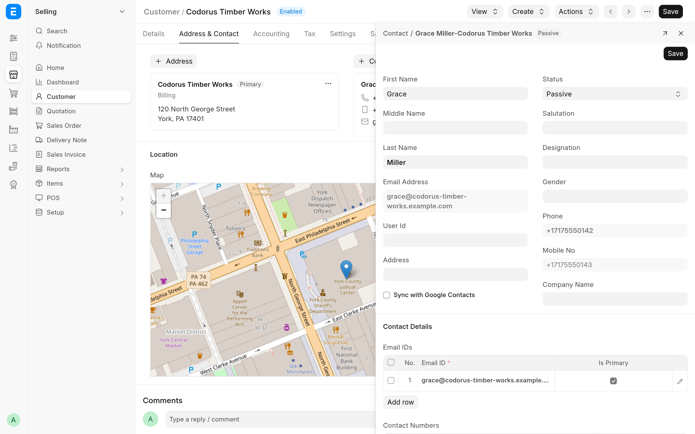

A Customer or Supplier keeps its addresses and contacts in separate Address and Contact records. With CIS Plus you edit them in Frappe's side panel, the drawer on the right of the desk, while the party's form stays open underneath with any unsaved changes you have made to it.

## Before you start

- The Customer or Supplier must be saved. A new, unsaved party has no address and contact cards; its first address and contact can come from ERPNext's own quick entry.
- Split view must be on, which it is unless you turned it off: the **Split view** switch on the **Reports** tab of your **Settings**. The side panel is never used on a phone.
- To open a card in the panel you need write access to Addresses (for address cards) or Contacts (for contact cards). To add one there you need create access too. Without them the cards keep their standard behaviour.

When any of these is missing, the cards work as they do without the app: the card menu's **Edit** opens the full form, and the add buttons open the quick entry.

## Edit an address or contact

1. Open the Customer or Supplier and go to the **Address & Contact** tab.
2. Click an address or contact card (or focus it with Tab and press Enter). It opens in the side panel as a form.
3. Change what you need.
4. Click **Save** at the top of the panel, or press Ctrl+S (Cmd+S on a Mac). While the panel has focus, Ctrl+S saves the record, not the party.

An alert confirms the save, the panel shows the saved record, and the party's cards and **Location** map are brought up to date without reloading the party's form.

Clicking a phone number, an e-mail address or the card's menu button does what it always did; only a click on the rest of the card opens the panel. The card menu keeps **Edit** (the full form), **Set as Primary** or **Unset as Primary**, and **Unlink Address** or **Unlink Contact**.

## Add an address or contact

1. On the **Address & Contact** tab, click the **Address** or **Contact** button (with the plus sign), or **New Address** or **New Contact** when the party has none yet.
2. The side panel opens a new record, titled **New Address** or **New Contact**, with the defaults a new form would have. A new Address's **Address Title** is the party's name.
3. Fill it in and click **Save**.

The new record is linked to the party. If the party has no primary record of that kind yet, the new one is marked primary (**Preferred Billing Address** on an Address, **Is Primary Contact** on a Contact) and becomes the party's primary address or contact. When the party's form had no other unsaved changes, it is saved for you; otherwise it is left changed for you to save.

### The country of a new address

On a new Address in the side panel, **Country** is not required, and its description reads "Leave empty to take the country the address lookup finds." When you leave it empty, the Address takes, in this order:

1. The country of the geocoding result. See [Address geocoding and maps](geocoding.md).
2. On a Supplier, the Supplier's own **Country**.
3. The **Country** in System Settings.

## Phone numbers in E.164

When you save a Contact from the side panel, each new number in its **Contact Numbers** table is written in E.164, the international format with a plus sign and country code, such as `+17175550142`. A number without a country code is read in the country of the party's primary address, or of System Settings when there is none.

- Numbers the Contact already had are left as they are, so saving never rewrites a number nobody edited.
- A number that is already valid E.164 is kept.
- A number that cannot be read as a valid phone number is kept as typed, and an alert says "`<NUMBER>` could not be read as a phone number and was kept as entered".

Numbers entered on the full Contact form, or anywhere else, are not converted.

## The default primary address and contact

When you open a saved Customer or Supplier that has no primary address, the first Address linked to it (the oldest) is selected as its primary address; the same goes for contacts. The form is left changed, so the choice is kept only when you save the party.

## What the side panel form leaves out

- The **Map**. Geocoding draws it when the Address is saved; open the full form to see it.
- The **Links** table. The record stays linked to its parties. To link it to another party or unlink it, use the full form or the card menu.
- Fields you may not read. Fields you may not write are shown read-only.

A child table, such as a Contact's **Email IDs** or **Contact Numbers**, is edited in its grid, as in a dialog. The arrow button in the panel's header (**Open in full page**) closes the panel and opens the record's full form.

> [!WARNING]
> Closing the panel, opening another record in it or moving to another page drops unsaved edits in the panel without asking.
